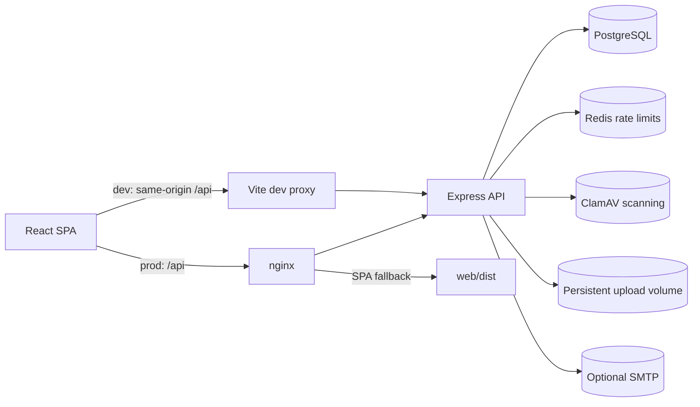

# Architecture

## System overview



HelpDesk Pro is a same-origin web application. In development, Vite serves the React app on `127.0.0.1:5173` and proxies `/api` to the Express API on `127.0.0.1:3000`. In production, nginx serves the built SPA and proxies `/api` to Express; Express can also serve `web/dist` directly. There is no CORS layer by design.

## Technology stack

| Layer | Technology |
|---|---|
| Frontend | React 19, Vite 8, Recharts 3, plain CSS with light/dark themes |
| Backend | Node.js 20.19+, Express 5, Zod 4, jsonwebtoken, bcryptjs, multer, Nodemailer |
| Database | PostgreSQL 16 via `pg`; migrations and seeds are manual scripts |
| Tests | Vitest 5, Testing Library, jsdom, Supertest, Playwright |
| Container | Docker Compose for local PostgreSQL and a production override with app/web/PostgreSQL/Redis/ClamAV images |

## Frontend structure

| Path | Responsibility |
|---|---|
| `web/index.html` | Mount point and pre-hydration theme bootstrap |
| `web/public/theme-bootstrap.js` | Applies saved theme before React renders |
| `web/src/main.jsx` | React root and global stylesheet |
| `web/src/App.jsx` | Authentication bootstrap, employee portal, role dispatch |
| `web/src/StaffApp.jsx` | Staff queue, detail, SLA, analytics, users, categories, audit |
| `web/src/AttachmentsPanel.jsx` | Upload, list, download, and delete attachments |
| `web/src/AnalyticsPanel.jsx` | Admin charts and accessible data tables |
| `web/src/CategoriesPanel.jsx` | Admin category/subcategory CRUD |
| `web/src/AuditPanel.jsx` | Admin audit-log filters and table |
| `web/src/api.js` | Fetch wrapper, CSRF handling, error parsing, upload/download helpers |
| `web/src/ui.jsx` | Shared UI primitives and formatters |
| `web/src/routing.js` | Browser history routing, deep-link parsing, redirect preservation |
| `web/src/AsyncBoundary.jsx` | Recoverable boundary for failed lazy chunks and imports |
| `web/src/SessionsPanel.jsx` | Active-session list and revocation dialog |
| `web/e2e/coreFlows.spec.js` | Playwright browser flows |

The application uses History API routing with `popstate` listeners, so every major view has a shareable URL. Unauthenticated deep links are stored in `sessionStorage` and restored after sign-in when the role is allowed. Lifecycle links with tokens render for both signed-in and signed-out visitors; admin-only staff views redirect unauthorized roles to the queue. The four top-level states are loading, public auth/lifecycle screens, `Workspace unavailable` for unsupported roles, and the role-appropriate employee or staff workspace.

`StaffApp` and the Recharts-only `AnalyticsPanel` are lazy-loaded, keeping chart code out of the initial entry chunk. `AsyncBoundary` presents a reload action if a chunk or lazy import fails to download.

## Backend structure

| Path | Responsibility |
|---|---|
| `server/src/app.js` | Middleware chain, router mounting, production static serving, error handling |
| `server/src/server.js` | HTTP listener and graceful shutdown |
| `server/src/config/env.js` | Environment validation and frozen config object |
| `server/src/db/` | Pool, migrations, seeds, demo data, database creation |
| `server/src/middleware/` | Auth, role checks, CSRF, validation, rate limits, errors |
| `server/src/modules/auth/` | Register, login, logout, current user, reset, verification, sessions |
| `server/src/modules/users/` | User profile and admin user management |
| `server/src/modules/catalog/` | Categories and subcategories |
| `server/src/modules/tickets/` | Ticket lifecycle, comments, history, triage |
| `server/src/modules/attachments/` | Attachment metadata, upload, download, deletion |
| `server/src/modules/sla/` | SLA rules and response report |
| `server/src/modules/analytics/` | Dashboard data |
| `server/src/modules/audit/` | Audit-log query API |
| `server/src/services/` | Audit, notifications, Redis rate-limit store, antivirus client |
| `server/src/jobs/` | Retention scheduler and one-shot CLI |

## Request flow

```text
Browser
  -> GET /api/auth/csrf (sets readable csrf_token cookie)
  -> unsafe request with x-csrf-token header + access_token cookie
  -> CSRF middleware compares header/cookie with timingSafeEqual
  -> auth middleware verifies JWT signature, algorithm, expiry, jti session, token_version, and active user
  -> role middleware checks employee/agent/admin access
  -> Zod validation
  -> route handler / service / database transaction
  -> { success: true, data, meta? } envelope
```

The API client automatically bootstraps CSRF when needed, adopts rotated CSRF tokens returned by login/register, and retries a CSRF rejection once after refreshing the token. This handles another tab rotating the shared CSRF cookie.

## Role model

| Capability | Employee | Agent | Admin |
|---|:---:|:---:|:---:|
| Register account | Yes | No | No |
| View own tickets | Yes | Yes | Yes |
| View all tickets | No | Yes | Yes |
| Create ticket | Yes | No | No |
| Assign / triage tickets | No | Yes | Yes |
| Internal notes | No | Yes | Yes |
| SLA report | No | Yes | Yes |
| Analytics | No | No | Yes |
| User management | No | No | Yes |
| Categories / audit | No | No | Yes |
| SLA rule editing | No | No | Yes |

The fixed roles are stored in the `roles` table and checked in `employee|agent|admin` checks. Unknown roles are shown a `Workspace unavailable` screen.

## Ticket and SLA lifecycle

```text
New -> Assigned -> In Progress -> Pending -> Resolved -> Closed
                \-> Cancel (from open states; stored as Closed + cancelled_at)
                \-> Reopen -> New (unassigned) or In Progress (assigned)
```

- `Cancelled` is not a separate status value: cancellation closes the ticket, sets `cancelled_at`, and uses fixed resolution notes. Reopening clears those fields.
- Requesters can edit only open tickets and can cancel, reopen, or confirm resolution.
- Closed tickets are immutable.
- Resolution notes are required when moving a ticket to `Resolved`.
- `first_responded_at` is set by the first public staff reply.
- SLA response deadlines are calculated from active rules by priority and recalculated on priority changes only while unanswered and open.
- SLA “met/breached” is derived from the first public response. Without a response, the UI shows `pending` or `unverified` rather than claiming compliance.
- Ticket detail, comments, and history are scoped so requesters never receive internal notes or internal-note history.

## Data integrity

- Audit logs and ticket history are append-only via database triggers.
- Ticket codes are generated by a PostgreSQL sequence (`HD-000001`, etc.).
- Email uniqueness is case-insensitive.
- Migrations are checksummed; editing an applied migration is rejected.
- Deletes for users, categories, and tickets are represented as soft deactivation where applicable.
- Retention removes aged audit/history rows through a `SECURITY DEFINER` function with a transaction-local trigger bypass.
- Attachment uploads are authorized before validation/write, counted against ticket/user quotas, and optionally scanned by ClamAV before being persisted.

## Deployment topology

Development uses two processes started by `npm run dev` through `concurrently`. `docker-compose.yml` provides local PostgreSQL. `docker-compose.prod.yml` builds `Dockerfile.server` and `Dockerfile.web`, adds Redis and ClamAV, and puts nginx in front of the SPA/API. nginx serves SPA routes with an `index.html` fallback and proxies `/api` to the Node service; the API also remains capable of serving `web/dist` directly. In the single-container Render deployment, `Dockerfile.server` runs migrations (`RUN_MIGRATIONS_ON_START=true`) and idempotent reference seeding (`SEED_REFERENCE_DATA_ON_START=true`) before Express listens; the Compose stack keeps both flags false because its one-shot `migrate` service already provisions schema and role.

Vercel uses the same repository from one project with two Services: `server/src/index.js` exports the Express app as a function without a listener, and the Vite service serves `web/dist`. Top-level rewrites route `/api/*` to Express and everything else to the SPA; a protected GET route handles retention on Vercel Cron instead of an in-process timer. Migrations and reference data remain explicit operator steps, and attachments/quarantine use private Vercel Blob storage.

See [Deployment](DEPLOYMENT.md) for environment variables and operational steps.
