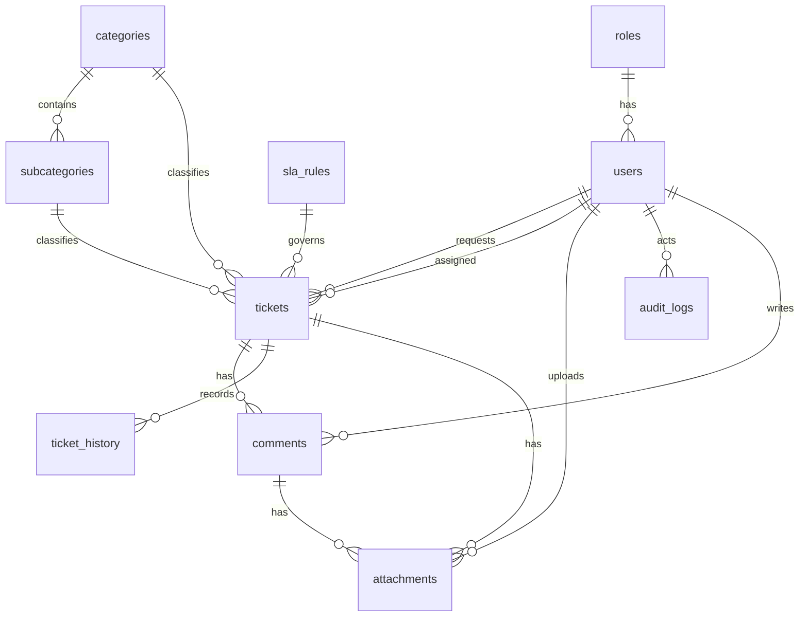

# Database schema

PostgreSQL is the single source of truth for application data, dashboard figures, SLA calculations, and audit history.

## Migrations

Migrations live in `server/src/migrations/` and are applied manually with `npm run migrate`:

| File | Purpose |
|---|---|
| `001_initial_schema.sql` | Core tables, constraints, ticket-code sequence, timestamp trigger |
| `002_indexes.sql` | Case-insensitive email uniqueness and query indexes |
| `003_append_only_guards.sql` | Triggers blocking updates/deletes on history and audit tables |
| `004_analytics_cancellation.sql` | Resolved-at indexing and cancellation fields |
| `005_session_revocation.sql` | `users.token_version` for global token invalidation |
| `006_repair_audit_and_cancellation.sql` | Allows FK-driven `actor_id` nulling; makes cancellation backfill deterministic |
| `007_account_lifecycle.sql` | `user_sessions`, `auth_tokens`, `email_verified_at`; backfills existing users as verified |
| `008_retention.sql` | `purge_expired_activity()` with a transaction-local append-only bypass |
| `009_lifecycle_integrity.sql` | Binds lifecycle tokens to an email hash, enforces one unused token per user/purpose, and adds session last-use tracking |
| `010_retention_grant.sql` | Grants migration/maintenance role `EXECUTE` on `purge_expired_activity(integer, integer)` |
| `011_append_only_least_privilege.sql` | Moves append-only tables/functions to a dedicated retention owner and binds the purge bypass to that role |
| `012_retention_owner_privileges.sql` | Explicitly grants the retention owner the rights needed after the ownership transfer |

`schema_migrations` stores `filename`, `checksum`, and `applied_at`. A PostgreSQL advisory transaction lock prevents concurrent migration runs. Applied migration files are checksummed and must not be edited.

## Entity relationships

## Tables

### `roles`

| Column | Notes |
|---|---|
| `id` | Primary key |
| `name` | Unique; checked to `employee`, `agent`, `admin` |
| `description`, `created_at`, `updated_at` | Metadata |

### `users`

| Column | Notes |
|---|---|
| `id` | Bigint primary key |
| `first_name`, `last_name`, `email` | Required; email unique case-insensitively |
| `password_hash` | bcrypt hash, cost 12 |
| `role_id` | Foreign key to `roles`, `RESTRICT` |
| `is_active` | Disabled users cannot authenticate |
| `is_demo` | Labels seeded demo accounts/items in the UI |
| `token_version` | Incremented on password reset to revoke all older JWTs |
| `email_verified_at` | Nullable verification timestamp; migration 007 backfills existing users |
| `created_at`, `updated_at` | Timestamps |

### `categories` / `subcategories`

Catalog tables with `is_active` soft-deactivation. `subcategories.category_id` cascades on delete; `(category_id, name)` is unique.

### `sla_rules`

One rule per priority with `response_minutes > 0` and `is_active`. Seed defaults are Critical 60, High 240, Medium 480, and Low 1440 minutes.

### `tickets`

| Column group | Notes |
|---|---|
| Identity | `id`, `ticket_code` from `next_ticket_code()` (`HD-000001`) |
| Content | `title`, `description`, `resolution_notes` |
| Classification | `category_id` (`RESTRICT`), `subcategory_id` (`SET NULL`), `priority` |
| Lifecycle | `status`, `cancelled_at`, `response_due_at`, `first_responded_at`, `resolved_at`, `closed_at` |
| People | `requester_id` (`RESTRICT`), `assignee_id` (`SET NULL`), `sla_rule_id` (`RESTRICT`) |
| Metadata | `is_demo`, `created_at`, `updated_at` |

Constraints enforce that resolution notes accompany resolved/closed tickets and that closed tickets have a resolution timestamp.

### `comments`

`ticket_id` cascades, `author_id` is restricted, `body` is limited to 5000 characters, and `is_internal` controls requester visibility.

### `ticket_history`

Append-only record of actions, field changes, old/new values, actor, and timestamp. Actor is set to `NULL` if a user is ever removed. Requesters cannot see internal-note history.

### `attachments`

Stores `ticket_id`, optional `comment_id`, `uploader_id`, original/stored names, MIME type, and size. Files live on local disk under `UPLOAD_DIR`; the database stores metadata. Per-file size is capped by `MAX_UPLOAD_BYTES` (default 5 MiB, configurable up to 100 MiB), with aggregate ticket/user quotas on top.

### `audit_logs`

Append-only records with actor, action, entity type/id, JSON details, IP address, and timestamp. Used by the admin audit panel.

### `user_sessions`

One row per JWT session: `jti`, SHA-256 token hash, user ID, IP address, user agent, creation/expiry/last-use timestamps, and `revoked_at`. Authenticated requests refresh `last_used_at`; logout revokes the current row and password reset revokes all rows for the user. The API lists active and revoked sessions and supports per-session revocation. Expired rows are removed by the retention job.

### `auth_tokens`

Single-use opaque links for `password_reset` and `email_verification`. Only a SHA-256 token hash is stored, with user ID, purpose, email hash, issue/expiry/use timestamps. A new request invalidates older unused links for the same user and purpose; changing the email address invalidates verification links for the old address. Expired rows are removed by the retention job.

## Indexes

Important indexes cover:

- Role and active-user lookups.
- Case-insensitive email uniqueness.
- Subcategories by category.
- Ticket status/priority, assignee/status, requester/creation date, creation date, category, demo flag, resolved date, and open SLA deadlines.
- Comments, history, attachments, and audit filters by created date, actor, and entity.

## Triggers

- `set_updated_at()` maintains `updated_at` on mutable tables.
- `reject_append_only_mutation()` raises `check_violation` on `UPDATE` or `DELETE` against `ticket_history` and `audit_logs`. Migration 006 permits only the `UPDATE` produced by `ON DELETE SET NULL` for `actor_id`, so historical records survive user cleanup without allowing edits to event content.
- `purge_expired_activity()` deletes aged `audit_logs` and `ticket_history` rows through a `SECURITY DEFINER` function owned by `helpdesk_retention`. Migrations 011 and 012 bind the transaction-local trigger bypass to that role and give the application role no `DELETE` privilege on append-only tables. Migration 010 (re-granted by 011) gives the maintenance role `EXECUTE` on the function; the retention job also deletes expired `user_sessions` and `auth_tokens` rows.

## Seed data

`npm run seed` is idempotent and creates:

- The three roles.
- Four SLA rules.
- Six categories with sixteen subcategories.
- Bootstrap admin/agent/employee accounts when configured.

In production, bootstrap users are skipped unless `ALLOW_PRODUCTION_BOOTSTRAP_USERS=true`.

`npm run seed:demo` is guarded by an advisory lock, a production check, and `SEED_DEMO_PASSWORD`. It adds labelled demo users, eight `[DEMO]` tickets with SLA deadlines, comments/history, and an audit entry. Re-running skips when demo data already exists.

## Operations notes

- Migration runs are opt-in at startup with `RUN_MIGRATIONS_ON_START=true`; seeds remain manual.
- `npm run db:create` creates configured databases; `npm run db:setup` creates, migrates, and seeds.
- Tests require `TEST_DATABASE_URL` to point to a different database from `DATABASE_URL`.
- `npm run retention` runs one purge immediately; the server can also schedule it with `RETENTION_ENABLED=true`.
- Back up both PostgreSQL and `UPLOAD_DIR`; neither the attachment files nor their metadata alone are sufficient.
