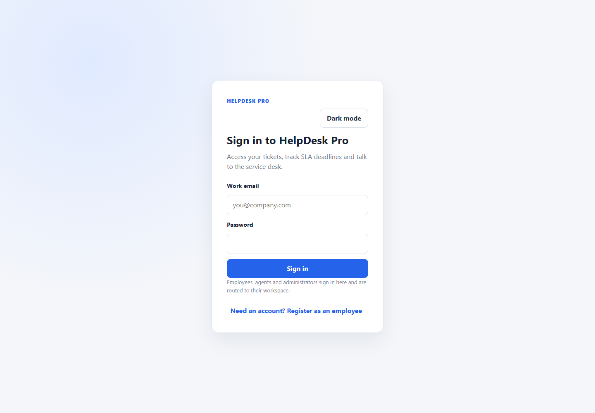
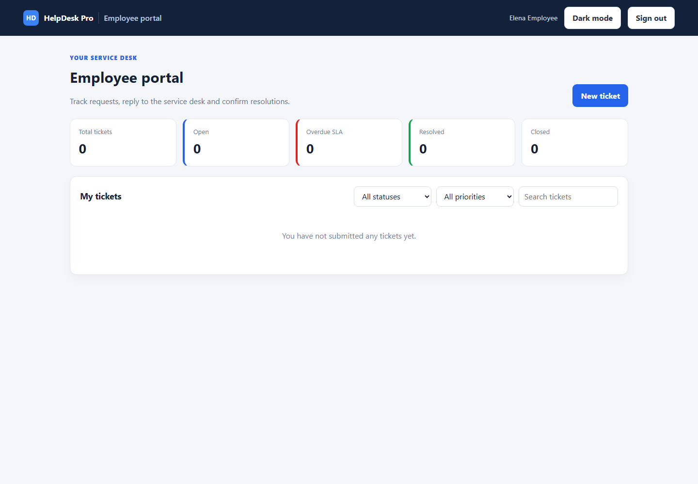
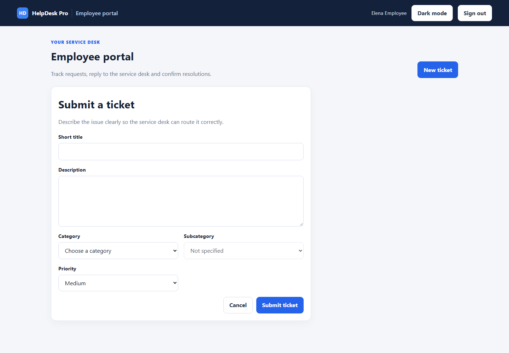
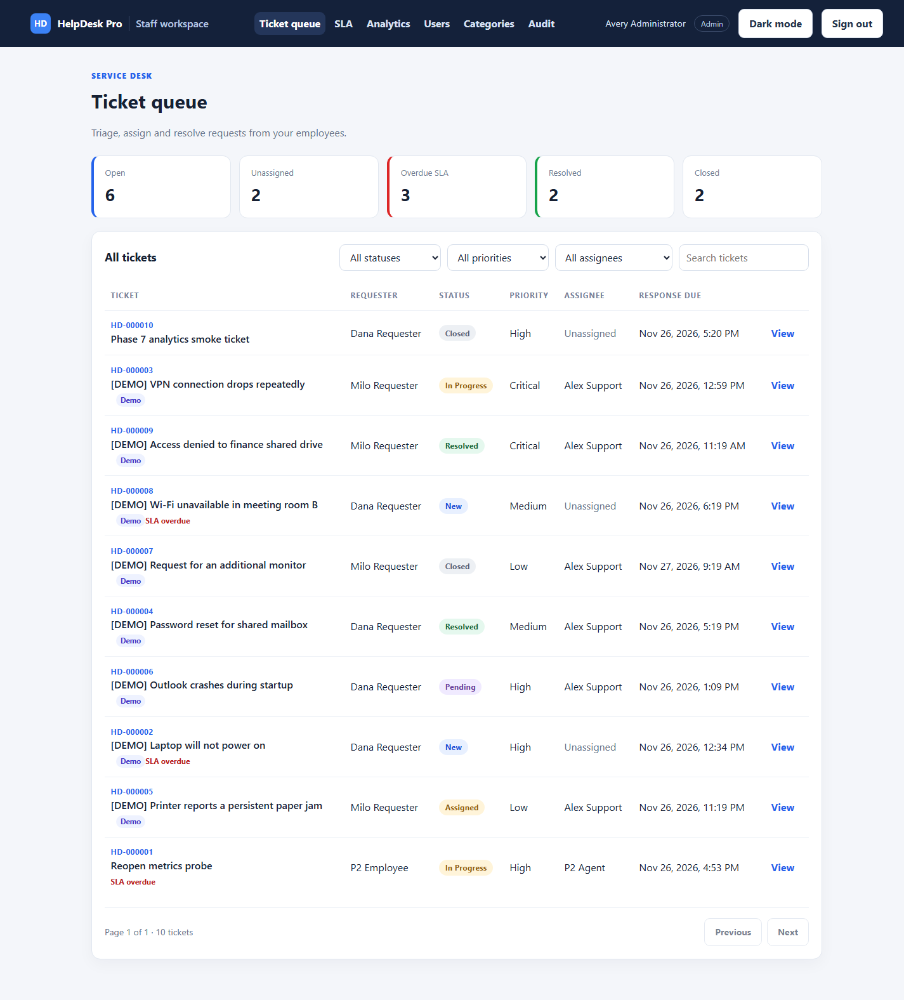
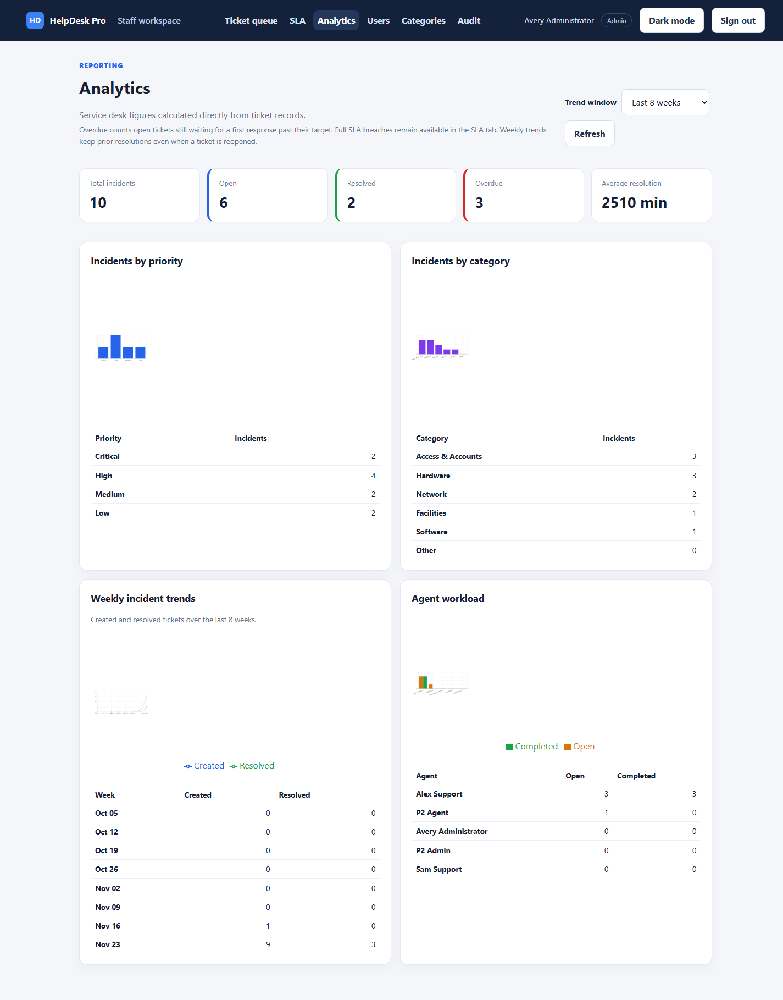
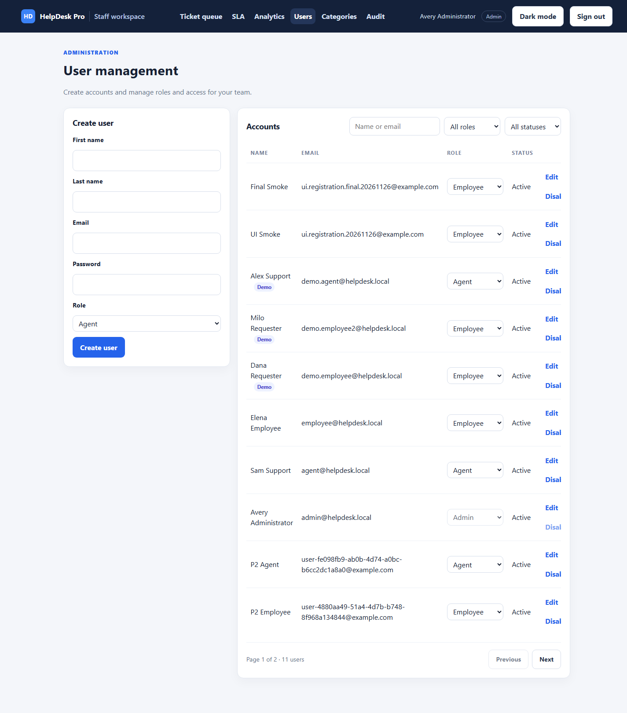
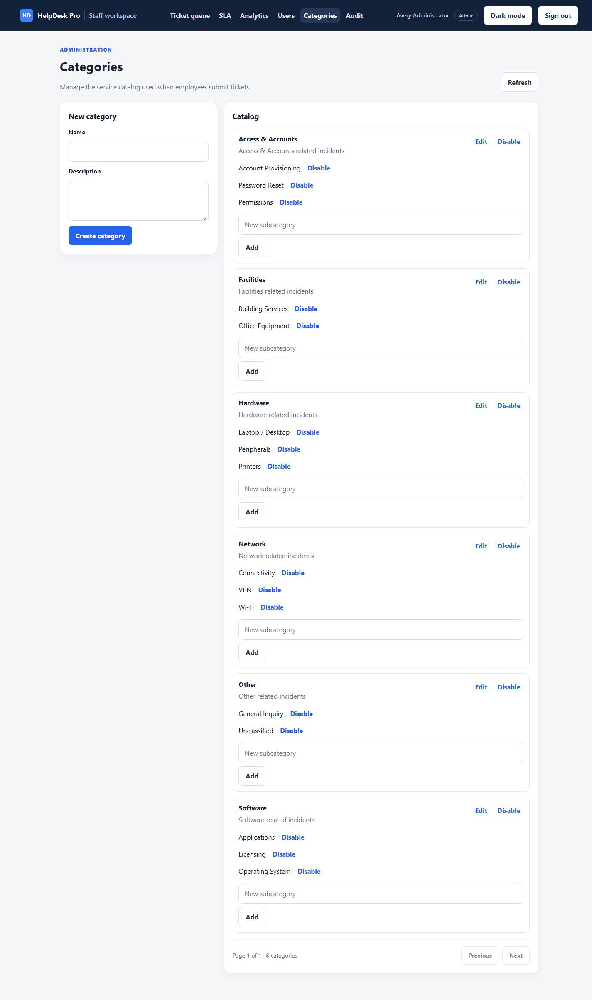
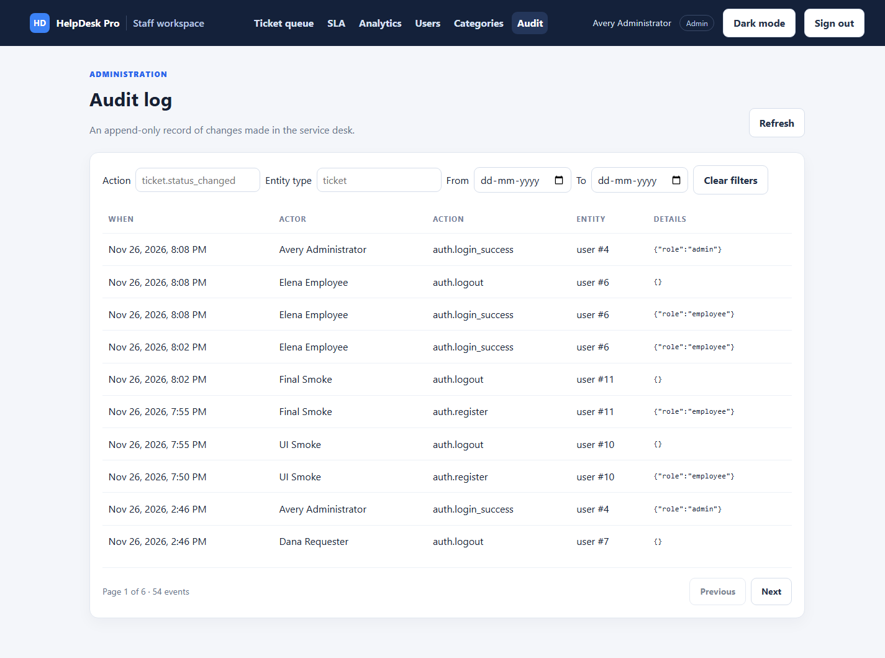
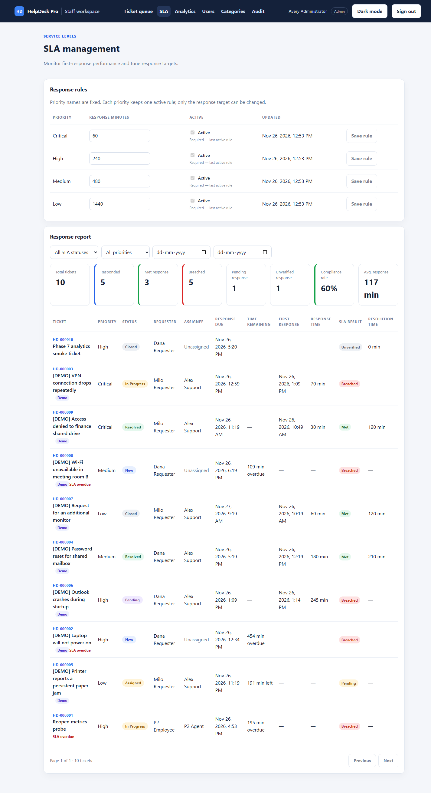

# HelpDesk Pro documentation

This folder contains the completed Phase 10 documentation package for HelpDesk Pro. Phase 10 added production hardening, account lifecycle features, URL routing, and browser end-to-end tests.

## Documentation index

| Document | Purpose |
|---|---|
| [Architecture](ARCHITECTURE.md) | System design, request flow, role model, and module layout |
| [API reference](API_REFERENCE.md) | HTTP endpoints, authentication, validation, errors, and envelopes |
| [Database schema](DATABASE_SCHEMA.md) | Tables, relationships, migrations, indexes, triggers, and seed data |
| [User guide](USER_GUIDE.md) | Step-by-step workflows for employees, agents, and administrators |
| [Deployment guide](DEPLOYMENT.md) | Local development, production build, environment variables, and operations |
| [Security notes](SECURITY.md) | Implemented controls and accepted residual risks |
| [Testing report](TESTING.md) | Test strategy, commands, final results, and live verification |
| [Phase 10 status](STATUS.md) | Completion status, delivered scope, and residual decisions |

## What the application does

HelpDesk Pro is a full-stack IT service desk with three roles:

- **Employees** register, submit tickets, reply to the service desk, edit open tickets, cancel or reopen tickets, confirm resolutions, and manage their own attachments.
- **Agents** work the shared queue, assign tickets, triage status and priority, reply publicly or internally, and manage SLA response rules/reporting.
- **Administrators** have all agent capabilities plus user management, category/subcategory management, analytics, and the audit log.
- **All users** can request a password reset, verify an email address, and view or revoke active sessions.

All dashboard and chart figures are queried from PostgreSQL. There are no hard-coded dashboard statistics in the application. Major views use shareable URLs and survive refresh.

## Quick start

From the project root:

```bat
cmd /c npm run db:setup
cmd /c npm run seed:demo
cmd /c npm run dev
```

`npm run dev` starts both the API on port 3000 and the Vite frontend on port 5173. Starting only the frontend will produce proxy `502` responses because `/api` has no backend to forward to.

Open <http://127.0.0.1:5173>.

Demo accounts:

| Role | Email | Password |
|---|---|---|
| Administrator | `admin@helpdesk.local` | `ChangeMe123!` |
| Agent | `agent@helpdesk.local` | `ChangeMe123!` |
| Employee | `employee@helpdesk.local` | `ChangeMe123!` |
| Demo employee with sample tickets | `demo.employee@helpdesk.local` | `Demo12345!` |

## Screenshots

These are real captures from the running local application on 2026-11-26, not mockups.

### Sign in



### Employee portal



### Employee new-ticket form



### Staff ticket queue



### Admin analytics



### Admin user management



### Admin category management



### Admin audit log



### SLA management



> Note: screenshots are identified by screen name. The live application now uses URL routing, so these views also have deep links such as `/staff/analytics` and `/tickets/42`; unauthenticated links are restored after sign-in.
