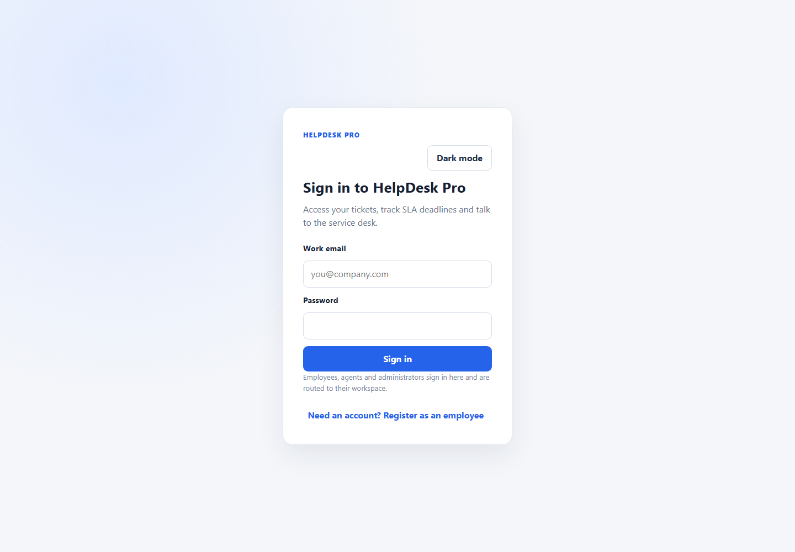
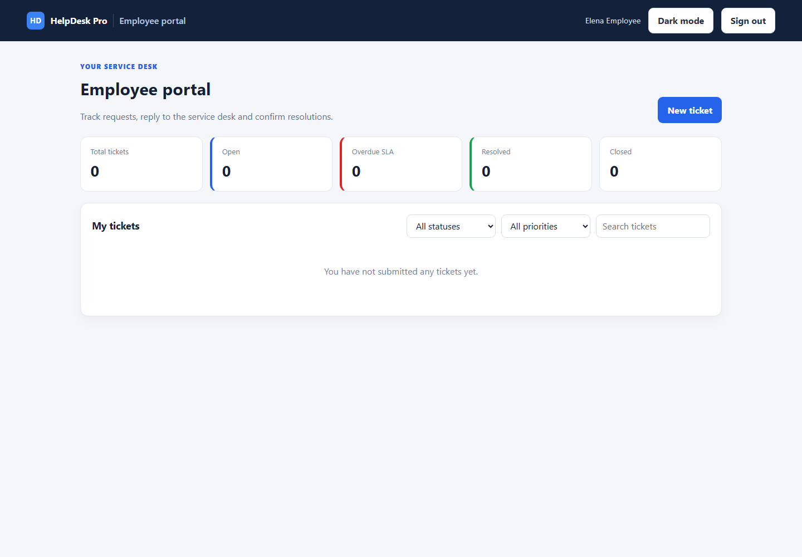
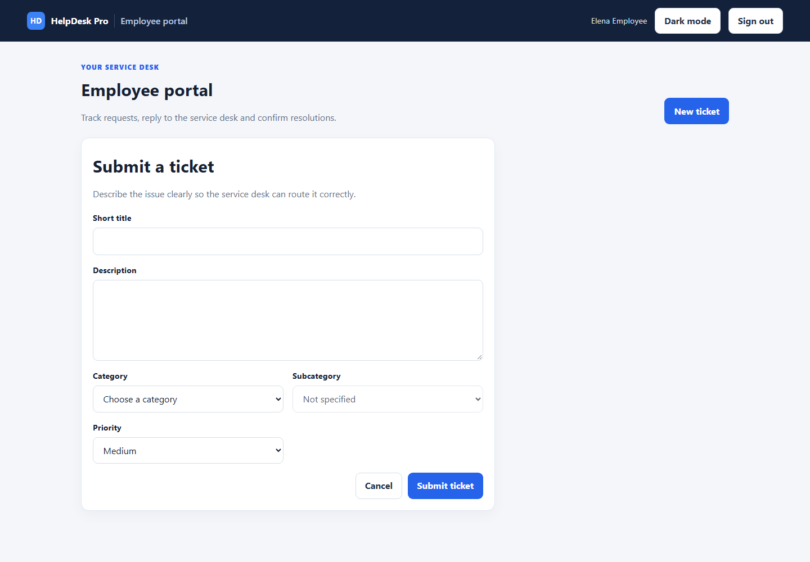
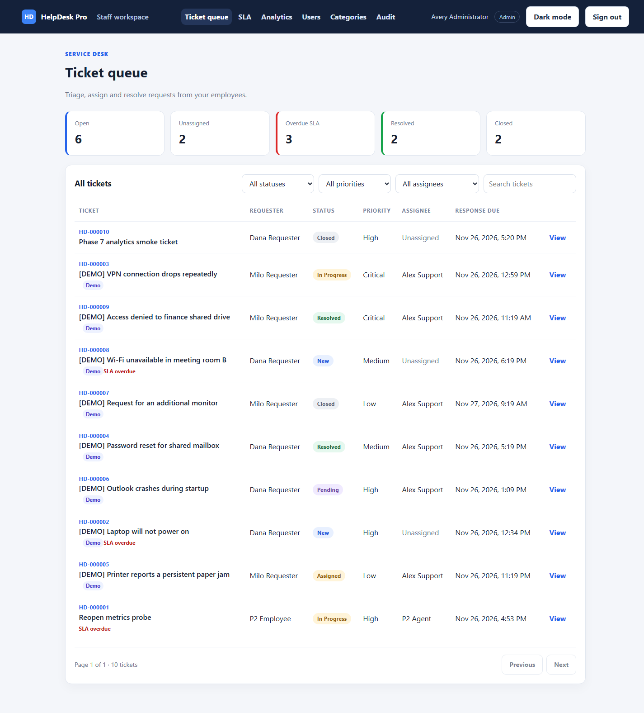
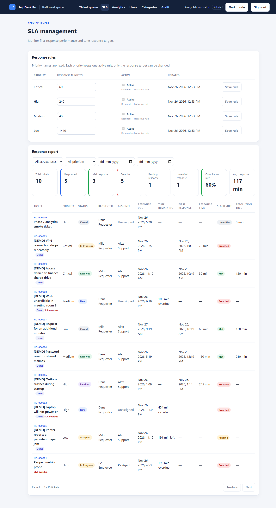
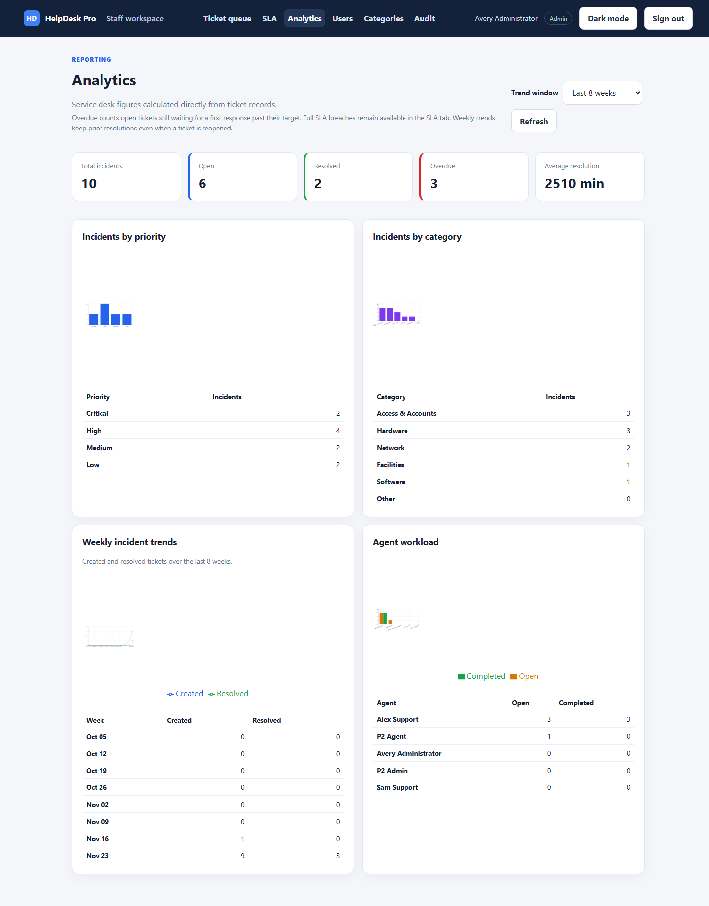
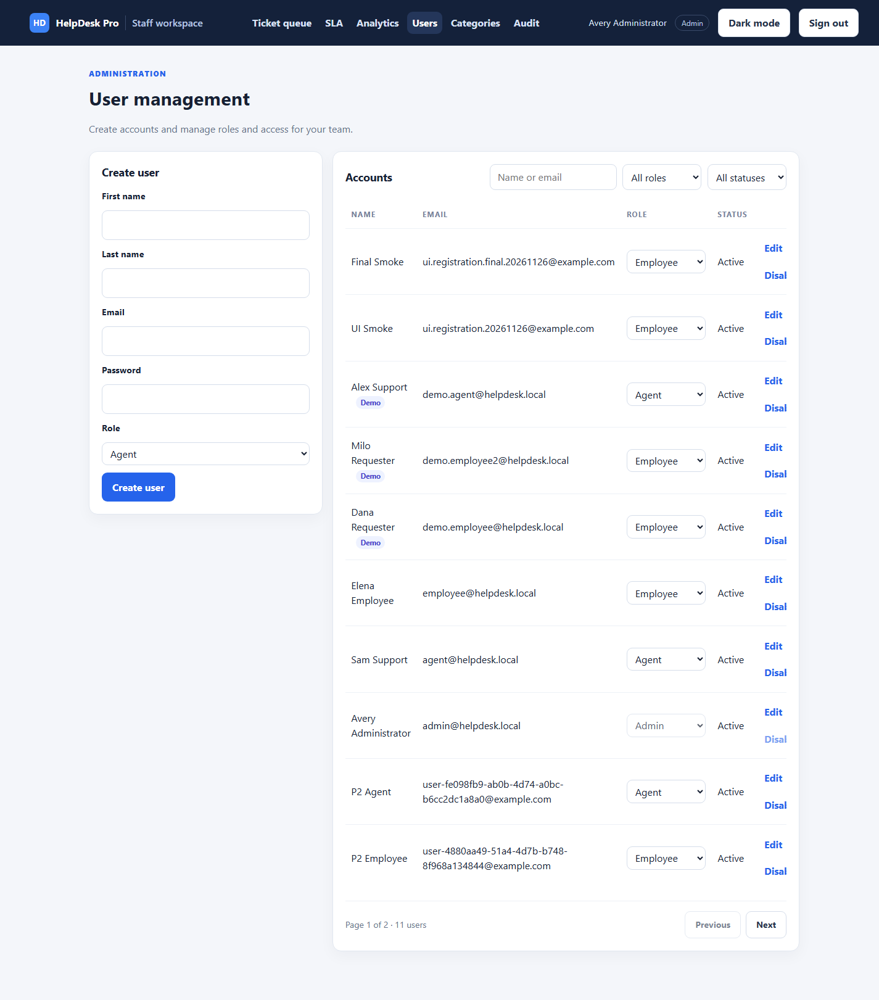
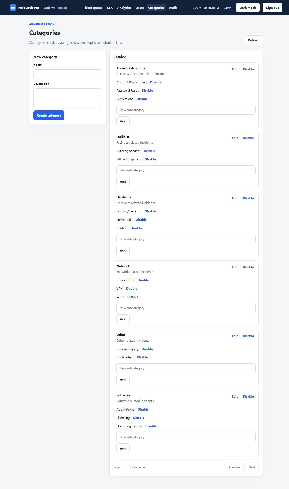
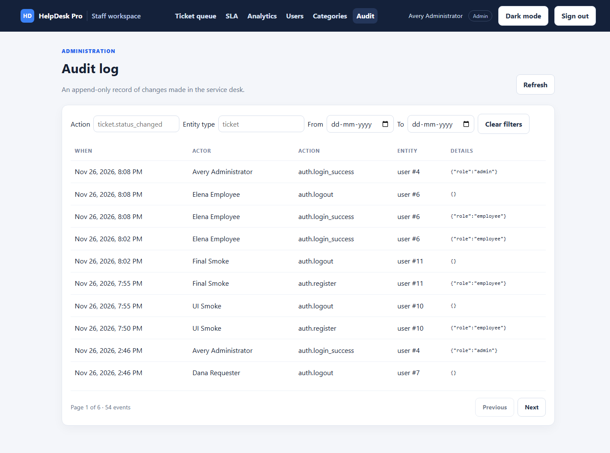

# User guide

## Signing in

1. Open <http://127.0.0.1:5173>.
2. Enter your work email and password.
3. Select **Sign in**.

The application routes you automatically: employees open the employee portal, agents open the ticket queue, and administrators open the same queue with additional admin navigation. Accounts with unsupported roles see **Workspace unavailable** and can sign out.

Every major view has a URL. If you open a deep link such as `/tickets/42` or `/staff/analytics` while signed out, the app stores that destination, sends you to `/login`, and returns you there after a successful sign-in when your role permits it. A link to a ticket that does not exist shows `Ticket not found` and returns to the dashboard; an admin-only staff link redirects other roles to the ticket queue. Browser Back and Forward navigate between views.

Use the theme toggle on the sign-in screen or in the header to switch between light and dark mode. The choice is stored in that browser profile.

## Registering as an employee

1. On the sign-in screen, select **Need an account? Register as an employee**.
2. Enter first name, last name, work email, password, and confirmation.
3. Select **Create account**.

The password must be 10–128 characters and include upper case, lower case, a digit, and a special character. Mismatched confirmations are rejected before the request is sent. A duplicate email returns a clear conflict message.

Successful registration signs you in as an employee immediately when email verification is not required. If the deployment requires verification, registration shows the verification screen instead and sign-in stays blocked until the emailed link is opened. If the backend is not running, the page shows: “The service is unavailable. Make sure the backend is running, then try again.”

## Resetting a password or verifying an email

1. Select **Forgot your password?** on the sign-in screen to open `/reset-password`.
2. Enter your work email and select **Send reset link**. The confirmation is deliberately generic and does not reveal whether the account exists.
3. Open the single-use link in the email. It leads to `/reset-password?token=...`, where you enter and confirm a new password.
4. Select **Update password** and then sign in with the new password. Resetting revokes every existing session for that account.

If the deployment requires email verification, the emailed verification link opens `/verify-email?token=...` and is applied automatically. You can also open `/verify-email` without a token, enter your work email, and request a fresh link. Both links expire, only the newest unused link works, and changing your email address invalidates the old verification link.

## Employee portal

The portal shows live totals for total tickets, open tickets, overdue SLA, resolved, and closed. Charts and counts are queried from the database; none are hard-coded.

### Submitting a ticket

1. Select **New ticket**.
2. Enter a short title and a description.
3. Choose a category, then a subcategory.
4. Choose a priority.
5. Select **Submit ticket**.

After submission the filters reset, the list reloads, and the new ticket opens automatically.

### Finding and viewing a ticket

Use the status filter, priority filter, and search box above **My tickets**. Select **View** on a row to open its detail. The detail page shows description, conversation, ticket details, activity, and attachments. Pagination uses ten tickets per page with **Previous** and **Next**.

Internal notes written by staff are never shown to employees.

### Working on a ticket

| Action | When available | What it does |
|---|---|---|
| **Add a reply** | Ticket is not closed | Sends a public message to the service desk |
| **Edit ticket** | Ticket is open | Edits title and description |
| **Cancel ticket** | Ticket is open | Closes the request and marks it as cancelled |
| **Reopen ticket** | Ticket is resolved or closed | Returns it to `New`, or to `In Progress` if an agent is assigned |
| **Confirm resolution** | Ticket is resolved | Closes the ticket |

If a reply fails to send, your draft text remains in the box.

### Attachments

In ticket detail, use **Add an attachment** to upload a file up to 5 MiB. You can download any visible attachment and delete only files you uploaded yourself. Closed tickets cannot accept new attachments, but downloads remain available.

## Agent workspace

Agents work from the shared ticket queue.

### Queue

Filter by status, priority, assignee (including **Unassigned**), and search. The table adds requester, assignee, and response due time. Select **View** to open a ticket.

### Ticket detail and triage

Staff detail adds **Triage**, **SLA**, and **Activity** sections. Available controls:

| Control | Purpose |
|---|---|
| **Assignee** + **Assign** | Assign or unassign the ticket |
| **Status** + **Update status** | Move through allowed transitions; resolution notes are required for `Resolved` |
| **Priority** + **Update priority** | Change priority and recalculate the SLA deadline when applicable |
| **Reply** + **Internal note** | Send a public reply or an internal note invisible to the employee |

Closed tickets are immutable. Internal notes are labelled in the conversation and hidden from requesters.

### SLA

Select **SLA** to open SLA management and the response report. The report filters by SLA status, priority, and date range. Without a first public response, compliance and average figures are shown as `—` instead of claiming a result.

## Administrator workspace

Administrators have all agent capabilities plus four additional sections.

### Analytics

Choose a four-, eight-, or twelve-week trend window and select **Refresh**. Charts cover incidents by priority, incidents by category, weekly trends, and agent workload. Every figure comes from the database. Accessible data tables accompany the charts, and empty charts display **No data available.**

### User management

Create users, edit names and emails, change roles, and disable/enable accounts. Search by name or email and filter by role/status. You cannot change your own role or disable your own account.

### Categories

Create, edit, enable, and disable categories and subcategories. Deactivation removes items from the employee-facing catalog without deleting historical tickets. Use **Refresh** after external changes.

### Audit log

Filter by action, entity type, date range, and other fields. **Refresh** reloads the database-backed log and **Clear filters** resets the view. The table shows raw JSON details for each event.

## Session management

Select **Sessions** in the header to open the **Active sessions** dialog. It lists each signed-in device with sign-in time, last-used time, expiry, and IP address where available. **This device** marks the current session. Expired sessions are labelled and cannot be revoked. Use **Sign out** on another active row to revoke that session, or **Sign out of other devices** to revoke all other active sessions. Select **Done** to close the dialog.

## Signing out

Select **Sign out** in the header. The app calls the logout endpoint, revokes only the current session, clears local session state, and returns to the sign-in screen. If the server cannot be reached, the app still clears local state and warns that the server session may remain active. Password resets revoke all sessions at once.
